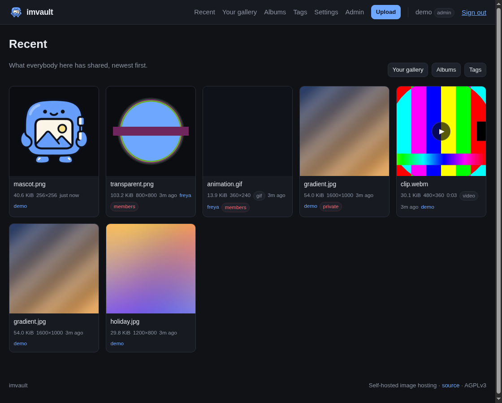

# Imvault


**A little vault for your big collection of “I should save that.”**

Photographs, screenshots, GIFs and short clips deserve a home that you run.
Imvault is a small, self-hosted image host in the spirit of MLKSHK, Picsur,
[Chibisafe](https://github.com/chibisafe/chibisafe) and
[Imgur](https://imgur.com): part personal library, part clubhouse noticeboard.

**Familyware, cozyware, friendware, software for your tribe.**

Built for dozens or hundreds of people who know why they're there. A cozy place
to swap family photos, save the group chat's finest screenshots, and keep the
little things your friends would appreciate.

One Go binary. Local storage by default, with optional S3-compatible buckets.
A small blue keeper with no opinions about how many pictures of your cat you
upload.

Public for an audience, members-only for your people, private for the
“I'll organise these later” collection. You decide who gets in.

<br clear="right">



*The local demo, stocked with sample media.*

**What's new:** see the [release notes](docs/release-notes/) and the
[latest release](docs/releases.md).

## Come on in

Try it locally first:

```bash
make demo
```

Open <http://localhost:8080>. The demo fills a throwaway `./demo-data`
directory with three accounts, sample media, a shared album, tags, an
invitation and a moderation queue, then prints the sign-ins and a short tour.
Ctrl-C closes up shop; `make clean-demo` sweeps up. Use `PORT=9000 make demo`
if somebody already parked on 8080, and `make help` for the rest of the
toolbox.

## Install

- **Packages and binaries.** Linux amd64 and arm64 archives and Debian packages
  are on [GitHub Releases](https://github.com/airencracken/imvault/releases).
  See [binary releases](docs/releases.md).
- **Containers.** Run the published image with Docker Compose. See
  [containers](docs/containers.md).
- **Gentoo, Alpine and other native installs.** `contrib/` has a live ebuild,
  an APKBUILD, and OpenRC and systemd services. See
  [deployment](docs/deployment.md).
- **From source.** You need Go 1.26.11 or later (1.27.4 or later on the 1.27
  series). There is no cgo.

  ```bash
  make run                              # :8080, data in ./data
  make run PORT=9000 DATA_DIR=/tmp/imv   # a different doorstep
  sudo make install PREFIX=/usr          # then make install-openrc or install-systemd
  ```

Then create the first owner, in a browser with `imvault setup` or at a terminal
with `imvault create-owner --username NAME`. See [setup](docs/setup.md).

Put Imvault behind HTTPS. The binary writes a starting proxy config for you:

```sh
imvault proxy-config caddy --domain img.example.com > imvault.Caddyfile
```

Use `nginx` or `apache` in place of `caddy`. See
[reverse proxies](docs/reverse-proxies.md). `imvault --help` lists every
command.

## What's in the vault?

| | |
| --- | --- |
| **Pictures that stay pictures** | JPEG, PNG, WebP, BMP, TIFF, and animated GIF and WebP. Thumbnails and previews are made once, with orientation and transparency handled. |
| **A home for little movies** | WebM, MP4 and MOV clips, served with range requests. Optional ffmpeg adds posters and duration checks; originals are never transcoded. |
| **A library, not a pile** | Galleries, albums, tags, private favorites, camera-date browsing, a recent feed and a 30-day Trash. Shared albums take contributions from members. Identical uploads share stored bytes. |
| **Your audience, your call** | Public, members-only and private visibility, with separate camera details and location switches on each photo. |
| **Keys for people and scripts** | Invitations, member, moderator and admin roles, TOTP two-factor sign-in, OpenID Connect, password resets and a bearer-token API. |
| **A broom cupboard** | Reports, a moderation log, account export and deletion, quotas, upload limits, rate limits, expiring anonymous uploads and queued mail. |
| **Room to grow** | Local disk or a private S3-compatible bucket, verified storage migration, and automatic and manual backups. |

Pages are server-rendered Go templates with htmx. There is no JavaScript build
step and no external service to set up. See [architecture](docs/architecture.md).

### A short tour

- **Favorite** a photo to keep it on your private **Favorites** page.
- **Rotate left** or **Rotate right** to fix a sideways photo. The original stays
  intact.
- Select photos in **Your gallery** to tag them, add them to an album, change
  their visibility.
- Add a name, bio, links and an avatar to your profile, choose a display
  timezone, and pick a **System**, **Light** or **Dark** theme.

See [organizing your library](docs/library.md), [media](docs/media.md) and
[accounts](docs/accounts.md).

## Your place, your house rules

Fresh installations require invitations and refuse anonymous uploads. The
public **About & house rules** page names your administrators and moderators,
who can see private uploads too. Add contact details and rules in settings.

Start from a **Personal**, **Group** or **Public** profile in **Admin →
Settings**, then adjust to taste. [Configuration](docs/configuration.md) covers
every setting.

## Running it

The keeper is cute. Backups are still your job.

- **Back up `secret.key` with the database and objects.** Without it, TOTP
  secrets cannot be decrypted. Imvault makes daily
  [automatic backups](docs/automatic-backups.md); [operations](docs/operations.md)
  covers manual backups, restores, upgrades and logs.
- **Use TLS and secure cookies.** Bind a native install to loopback and follow
  [deployment](docs/deployment.md).
- **Decide your house rules before opening the doors:** signup, anonymous
  uploads, retention and a storage ceiling.

| Guide | What's there |
| --- | --- |
| [Setup](docs/setup.md) | Creating the first owner |
| [Configuration](docs/configuration.md) | Settings, instance profiles, quotas and rate limits |
| [Accounts](docs/accounts.md) | Invitations, sign-in, two-factor, roles, profiles and moderation |
| [Library](docs/library.md) | Albums, tags, camera dates, bulk actions and Trash |
| [Media](docs/media.md) | Formats, previews, clips and photo metadata |
| [API](docs/api.md) | Managing your collection from scripts |
| [Routes](docs/routes.md) | Every URL the server answers |
| [Deployment](docs/deployment.md) | Native installs, services and TLS |
| [Containers](docs/containers.md) | Images, Compose, upgrades and backups |
| [Reverse proxies](docs/reverse-proxies.md) | Caddy, nginx and Apache |
| [Operations](docs/operations.md) | Backups, maintenance, upgrades and troubleshooting |
| [Storage](docs/storage.md) | S3, storage migration and backup and restore |
| [Sandbox](docs/sandbox.md) | Optional Bubblewrap confinement |
| [Comfyware connections](docs/suite.md) | App navigation, shared sign-in and discussions |
| [Album discussions](docs/discussions.md) | Talking about albums in Witmoot |
| [Security](docs/security.md) | The security model and its limits |
| [Architecture](docs/architecture.md) | Internals, checks and contributing |

## The honest rough edges

- Clips keep their original codecs. If a browser cannot play one, Imvault does
  not convert it. There is no adaptive streaming.
- Without ffmpeg, clips get placeholder posters and unchecked durations.
- When a format cannot be scrubbed of metadata, Imvault withholds the original
  from viewers who should not see it. Account exports keep originals.
- API keys manage files, albums and tags. Account settings, keys and admin work
  need a browser session.
- Email resets need an SMTP relay. Without one, administrators can issue reset
  links.
- Rate limits live in memory, per process.
- Two-factor sign-in is TOTP with recovery codes. There is no WebAuthn or
  hardware-key support yet.
- The optional location map is the only outbound request Imvault makes on its
  own. It is off unless `IMVAULT_MAP_URL` is set, and the map provider then sees
  the coordinates and your server's address.

## Support

You can [support Imvault on Ko-fi](https://ko-fi.com/airencracken).

## License

Copyright (C) 2026 Marcus J. Hildum.

GNU Affero General Public License, version 3 or later. See [LICENSE](LICENSE).
This program comes without any warranty.

The footer links to the source. If you run a modified version, point
`IMVAULT_SOURCE_URL` at its source.
